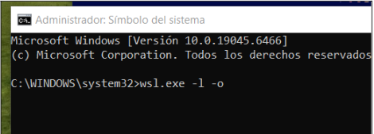
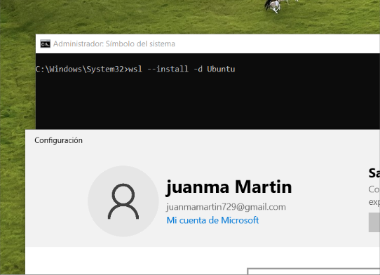
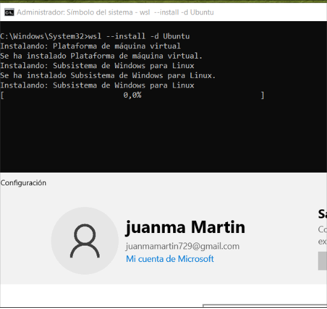
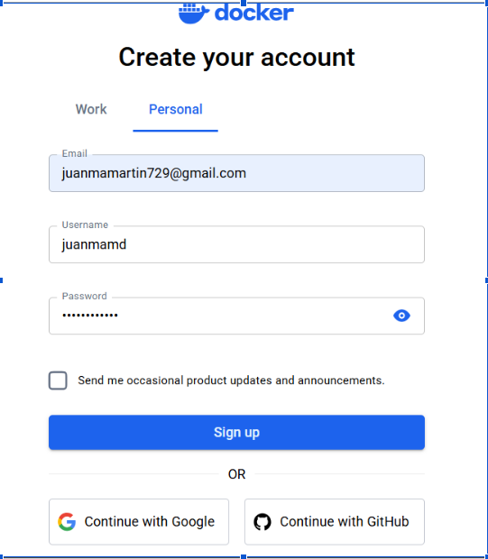
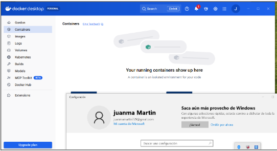

# IAW
## Descargando e instalando Docker ##

Lo primero será buscar en el navegador de google chrome el ejecutable de docker.exe para Windows en mi caso

Con este comando podremos ver las diferentes distribuciones que podemos descagar e instalar como subsistema linux en nuestro Windows

Vamos a instalar uno deseado, como el Ubuntu

Ya tenemos instalado el subsistema Linux ubuntu

Una vez tengamos todo lo anterior, ejecutamos docker para poder crear una cuenta nueva

Ya tan solo cuando hayamos creado la cuenta, iniciamos sesión, y nos aparecerá la ventana de inicio de docker.
