# IAW
## Descargando e instalando Docker ##
# Realizado por: Juanma Martin Delgado #

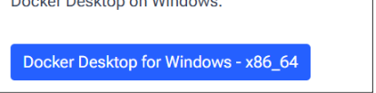

Lo primero será buscar en el navegador de google chrome el ejecutable de docker.exe para Windows en mi caso

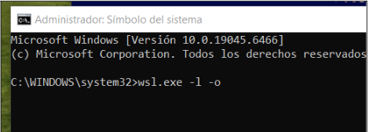

Con este comando podremos ver las diferentes distribuciones que podemos descagar e instalar como subsistema linux en nuestro Windows

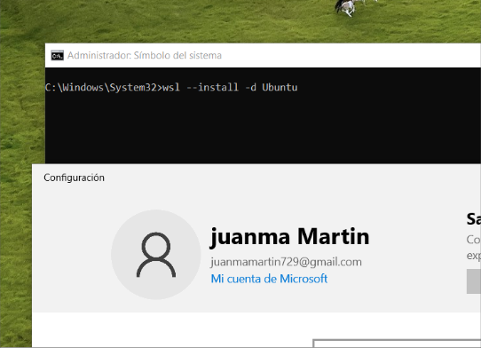

Vamos a instalar uno deseado, como el Ubuntu

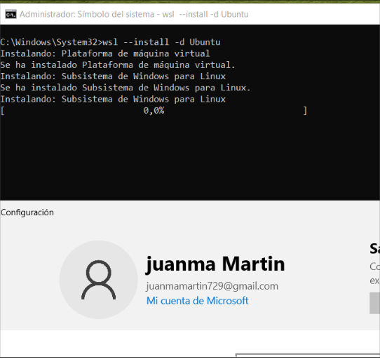

Ya tenemos instalado el subsistema Linux ubuntu

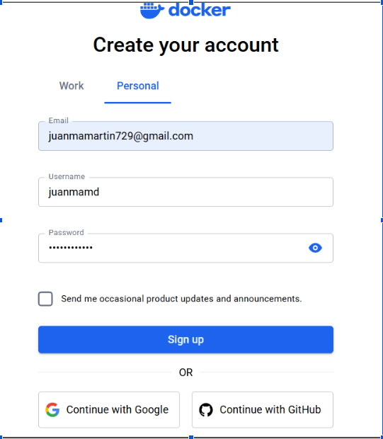

Una vez tengamos todo lo anterior, ejecutamos docker para poder crear una cuenta nueva

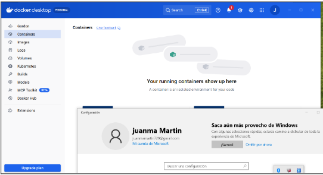

Ya tan solo cuando hayamos creado la cuenta, iniciamos sesión, y nos aparecerá la ventana de inicio de docker.


# IAW
## Descargando, inspeccionando y borrando imágenes en Docker ##
# Realizado por: Juanma Martin Delgado #

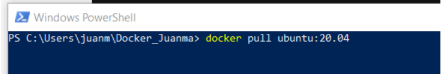

Lo primero será descargar la imagen de Ubuntu 20.04 con el comando docker pull

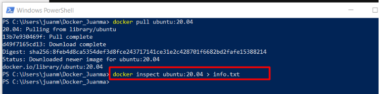

Con este comando guardaremos los datos de la imagen en el archivo info.txt

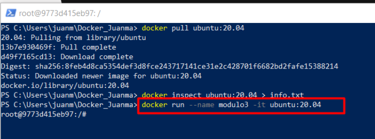

Vamos a crear un contenedor llamado modulo3 a partir de la imagen y a entrar en su terminal

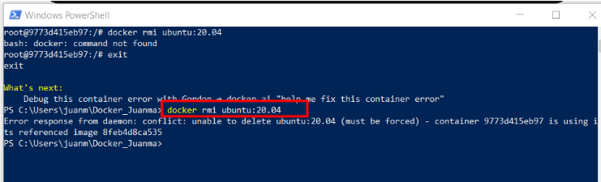

Si intentamos borrar la imagen no nos deja, ya que el contenedor modulo3 la sigue usando aunque esté parado

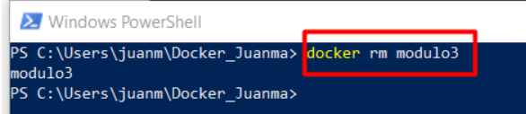

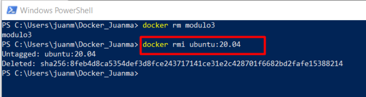

Una vez borrado el contenedor, ya podemos borrar la imagen de Ubuntu 20.04 con docker rmi

# Práctica de redes en Docker

**Juanma Martín Delgado · 2º GSI**

## 1. Crear red1 (con configuración manual)

La máscara 255.255.0.0 equivale a /16.

### Crear red1
```bash
docker network create --driver bridge --subnet 172.28.0.0/16 --gateway 172.28.0.1 red1
```
Se crea una red bridge con subred y puerta de enlace fijadas a mano. Docker devuelve el ID de la red, lo que confirma que se ha creado.

### Crear red2
```bash
docker network create --driver bridge red2
```
Aquí no se indica subred ni gateway, así que Docker los asigna automáticamente. Es la diferencia clave con red1.

### Error en `docker network ls`
```bash
docker network ls
```
El comando falló porque Docker Desktop no estaba en ejecución. Al iniciar el demonio de Docker, los comandos volvieron a funcionar.

### Inspección de red1
```bash
docker network inspect red1
```
Confirma la subred 172.28.0.0/16 y el gateway 172.28.0.1 configurados. Aún no tiene contenedores conectados (`"Containers": {}`).

## 2. Inspección de red2 y creación del primer contenedor

### Inspección de red2
```bash
docker network inspect red2
```
Docker eligió automáticamente la subred 172.18.0.0/16 y el gateway 172.18.0.1. Es la configuración por defecto, sin intervención del usuario.

### Crear u1 en red1
```bash
docker run -dit --name u1 --hostname host1 --network red1 --ip 172.28.0.10 ubuntu:20.04
```
Se lanza un contenedor Ubuntu en segundo plano (`-dit`) con IP fija dentro de red1. Se le asigna el nombre `u1` y el hostname `host1`.

## 3. Preparación de los contenedores

### Acceso a u1 e instalación de ping
```bash
docker exec -it u1 bash
apt update && apt install -y inetutils-ping
```
Se entra en la terminal del contenedor y se instala `ping`, que la imagen base no trae. Sin esta herramienta no se podrían hacer las pruebas de conectividad.

### Crear u2 en red2
```bash
docker run -dit --name u2 --hostname host2 --network red2 ubuntu:20.04
docker exec -it u2 bash
```
Se crea el segundo contenedor en red2, esta vez con IP automática. Después se accede a su terminal.

### Instalación de ping en u2
```bash
apt update && apt install -y inetutils-ping
```
Se repite la instalación en el segundo contenedor para poder hacer ping desde ambos lados. Los dos quedan listos para las pruebas.

### Comprobar la IP de u1
```bash
docker exec u1 hostname -i
```
Devuelve `172.28.0.10`, la IP fija asignada al crear el contenedor. Así se verifica que el parámetro `--ip` funcionó.

## 4. Pruebas de conectividad

### Inspección de redes de u1 y u2
```bash
docker inspect -f "{{json .NetworkSettings.Networks}}" u1
docker inspect -f "{{json .NetworkSettings.Networks}}" u2
```
u1 aparece solo en red1 (172.28.0.10) y u2 solo en red2 (172.18.0.2). Cada contenedor está en una red distinta.

### Ping sin conectividad
```bash
ping -c 3 host2
ping -c 3 172.18.0.2
```
El nombre `host2` no se resuelve y el ping por IP pierde el 100 % de los paquetes. Las redes bridge de Docker están aisladas entre sí.

### Conectar u1 a red2
```bash
docker network connect red2 u1
```
u1 pasa a tener una segunda interfaz, ahora también dentro de red2. Con esto comparte red con u2.

### Ping con conectividad
```bash
docker exec -it u1 bash
ping -c 3 172.18.0.2
```
Ahora los 3 paquetes llegan, con 0 % de pérdida y un tiempo medio de 0,239 ms. Queda demostrado que un contenedor conectado a dos redes puede comunicarse con ambas.
Por eso borramos primero el contenedor modulo3 con docker rm

# Tarea Módulo 6: Construyendo mis propias imágenes Docker

Práctica del Módulo 6 sobre creación de imágenes Docker
**Autor:** Juanma Martín Delgado
**Usuario de Docker Hub:** [juanmamd12](https://hub.docker.com/u/juanmamd12)

---

## Índice

1. [Requisitos](#requisitos)
2. [Tarea 6.2: Imagen a partir de un contenedor (`a62`)](#tarea-62-imagen-a-partir-de-un-contenedor-a62)
3. [Tarea 6.3: Imagen a partir de un Dockerfile (`a63`)](#tarea-63-imagen-a-partir-de-un-dockerfile-a63)
4. [Repositorios en Docker Hub](#repositorios-en-docker-hub)

---

## Tarea 6.2: Imagen a partir de un contenedor (`a62`)

Se crea un contenedor a partir de `ubuntu:20.04`, se instalan herramientas y se guarda el resultado como una imagen nueva.

### 1. Arrancar el contenedor

```bash
docker run -it --name contenedor_tarea ubuntu:20.04 bash
```

Para volver a entrar en un contenedor detenido:

```bash
docker start -ai contenedor_tarea
```

### 2. Instalar herramientas dentro del contenedor

```bash
apt update
apt install nano -y
apt install vim -y
apt install inetutils-tools -y
apt install dnsutils -y
```

### 3. Crear un usuario

```bash
adduser usuario
```

### 4. Guardar el contenedor como imagen

Desde la máquina anfitriona (Windows):

```bash
docker commit contenedor_tarea juanmamd12/a62
```

### 5. Comprobar y subir la imagen

```bash
docker images
docker push juanmamd12/a62
```

<!-- TODO: completar el push y añadir la captura de Docker Hub -->

---

## Tarea 6.3: Imagen a partir de un Dockerfile (`a63`)

Se construye una imagen a partir de `php:7.4-apache` con un `Dockerfile` propio.

### 1. Crear la carpeta de trabajo y descargar la imagen base

```bash
mkdir tarea63
cd tarea63
docker pull php:7.4-apache
```

### 2. Dockerfile

Contenido del archivo `Dockerfile`, guardado sin extensión:

```dockerfile
FROM php:7.4-apache

RUN apt-get update && apt-get install -y nano
RUN apt-get install -y git

RUN echo "HOLA SOY Juanma Martin" > /var/www/html/index.html
RUN echo "<?php phpinfo(); ?>" > /var/www/html/info.php
```

### 3. Construir la imagen

```bash
docker build -t juanmamd12/a63 .
```

<!-- TODO: repetir el build y capturar la salida completa hasta el final -->

### 4. Comprobar y subir la imagen

```bash
docker images
docker push juanmamd12/a63
```

### 5. Probar la imagen

```bash
docker run -d -p 8080:80 juanmamd12/a63
```

Después abre en el navegador `http://localhost:8080` (debe mostrar el texto de `index.html`) y `http://localhost:8080/info.php` (debe mostrar la página de `phpinfo`).

